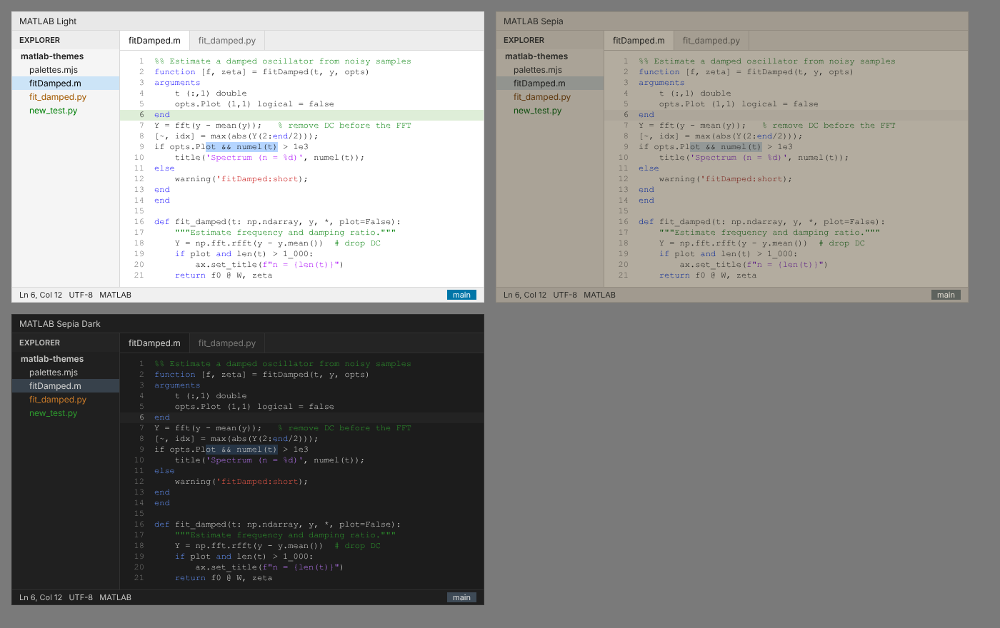

# MATLAB Themes

Three VS Code / Antigravity colour themes built around MATLAB's syntax colours.

| Theme | Use | Background |
|---|---|---|
| **MATLAB Light** | Daytime, next to a MATLAB window | White, MATLAB's documented editor defaults |
| **MATLAB Sepia** | Evening | Dim warm grey, imitating Dark Reader's brightness/sepia filter |
| **MATLAB Sepia Dark** | Night | Near-black |



Only MATLAB's four syntax classes are coloured: keywords, comments, strings and unterminated strings. Everything else is plain text, as in MATLAB. Semantic highlighting is off so language servers can't add colour back.

## Brightness

Click **◐ 100%** in the status bar (or run *MATLAB Themes: Set Brightness…*) and move through the list: each step previews live, Enter keeps it, Esc goes back. *Brighter* / *Dimmer* commands step by 5% and can be bound to keys.

The value is one setting, `"matlabThemes.brightness"` (60–100). It scales every colour's OKLab lightness, the same operation as the brightness slider in the browser extension, so equal percentages give identical colours in both.

How it works: the designed themes live in `themes/base/`; `extension.js` rewrites `themes/*.json` from them. The themes are contributed with `"_watch": true`, so VS Code re-applies a theme when its file changes. If an editor doesn't (the preview won't move), set `"matlabThemes.reloadWindow": true` to reload the window after each change instead.

Only colours the theme controls are affected. Icons that extensions draw themselves (toolbar logos, Marketplace pictures) keep their own colours.

## Install

Extensions view → `…` → **Install from VSIX…** → `dist/matlab-themes.vsix`. Pick a theme with `Ctrl+K Ctrl+T`.

## Layout

```
palettes.mjs        the three palettes (~40 role colours each); edit these
build.mjs           turns palettes into themes/*.json and syncs package.json
themes/base/        generated theme files, as designed
themes/             the files VS Code loads; rewritten by extension.js for brightness
extension.js        brightness control
dist/               packaged .vsix
settings/           editor settings.json (no colours in it)
preview/            renders preview/themes.png
```

```
npm run build      # regenerate themes/*.json
npm run package    # regenerate + build dist/matlab-themes.vsix
```

## Matching browser theme

The companion browser extension, MATLAB Themes for the Web, lives in [jntnlx/browser-extensions](https://github.com/jntnlx/browser-extensions/tree/main/matlab-themes-web). Its colours are generated from `palettes.mjs` here.

## Where MATLAB Light's colours come from

MathWorks documents the light-theme defaults in the `matlab.colors`, `matlab.colors.programmingtools` and `matlab.editor` settings:

| Element | MATLAB setting | Colour |
|---|---|---|
| Keywords | `KeywordColor` | `#0E00FF` |
| Comments | `CommentColor` | `#028009` |
| Strings | `StringColor` | `#AA04F9` |
| Unterminated strings | `UnterminatedStringColor` | `#C40000` |
| Syntax errors (squiggles) | `SyntaxErrorColor` | `#FF0000` |
| Code Analyzer warnings | `CodeAnalyzerWarningColor` | `#FF9400` |
| Code Analyzer info | `CodeAnalyzerInfoColor` | `#1656A7` |
| Current line | `HighlightCurrentLineColor` | `#DEEED8` |
| Variable highlight (occurrences) | `VariableHighlightColor` | `#CAE8E8` |
| Autofix highlight (find matches) | `AutofixHighlightColor` | `#EEE1B4` |
| Text limit line (rulers) | `linelimit.LineColor` | `#CCCCCC` |
| Markdown headings / links | Live Editor Markdown | `#C04C0B` / `#1171BE` |

Window chrome (sidebar, tabs, status bar) isn't documented and is approximated with neutral greys and MathWorks blue. Adjust `bg1`–`bg3` in `palettes.mjs` against your MATLAB window for a closer match.
